# Parking Entry Queue and Vehicle Records System

## Project Title
Parking Entry Queue and Vehicle Records System

## Project Description
This application addresses the problem of vehicle congestion and entry gate delays at parking facilities. When cars arrive at peak hours, managing parking availability and tracking registered vehicles becomes difficult. This console based Java application solves the problem by organizing arriving vehicles into a First In, First Out (FIFO) queue for fair entry processing while keeping all registered vehicle records synchronized and searchable using parallel data structures.

## Objectives
- Manage arriving vehicles using a First In, First Out queue to process parking entries in arrival order.
- Implement three manual sorting algorithms from scratch to organize vehicle records without using built in Java sorting utilities.
- Store related vehicle information using synchronized static parallel ArrayLists following procedural programming rules.
- Build a user friendly terminal interface complete with sub-menu navigation, parking capacity tracking, and input validation.

## Use Cases and Features

### Vehicle Registration
- Register New Vehicle: Captures plate number, vehicle type, driver name, arrival time, and priority level. Rejects duplicate plate numbers and automatically adds the vehicle to the waiting queue.
- Display All Vehicles: Prints all registered vehicle records in a structured table.
- Search by Plate Number: Look up a specific vehicle using its plate number.

### Queue Operations
- Display Waiting Queue: Shows all vehicles currently waiting in line from front to back.
- Peek Next Vehicle: Checks details about the vehicle at the front of the queue without removing it.

### Sorting Records
- Sort by Plate Number: Organizes stored records alphabetically by plate number using Bubble Sort.
- Sort by Vehicle Type: Groups vehicle records alphabetically by type using Selection Sort.
- Sort by Entry Time: Orders records chronologically according to arrival time using Insertion Sort.
- Displays vehicle records before and after running each sorting operation.

### Parking Operations
- Allow Vehicle to Enter: Moves the vehicle at the front of the queue into an open parking slot as long as the lot has space.
- Vehicle Exit: Lists currently parked vehicles and lets a selected vehicle leave, freeing up a parking slot.

## Data Structure Explanation

- Parallel ArrayLists: Information is stored across five separate static ArrayList structures to keep record attributes connected without using custom classes or objects:
  - plateNumbers
  - vehicleTypes
  - driverNames
  - entryTimes
  - priorityNumbers
  When records are sorted or rearranged, the application swaps values at matching index positions across all five lists at the exact same time so information stays connected to the correct vehicle.

- Waiting Queue: Manages incoming vehicles using an ArrayDeque queue structure. The first vehicle added to the queue using the offer operation is always the first one processed and removed using the poll operation, ensuring true First In, First Out behavior.

- Parked Vehicles: Uses an ArrayList to keep track of vehicles that have entered the facility up to the maximum capacity limit of 30 slots.

## Sorting Algorithm Explanation

1. Bubble Sort (by Plate Number): Iterates through the list of plate numbers, comparing adjacent entries side-by-side using compareToIgnoreCase. If two plates are out of alphabetical order, the program swaps them and their corresponding details across all parallel lists.

2. Selection Sort (by Vehicle Type): Scans the list to find the alphabetically smallest vehicle type and swaps it with the item at the current starting index, repeating this process for every position in the list.

3. Insertion Sort (by Entry Time): Processes entry times sequentially, taking each time value and shifting it backward into its proper relative position among the previously sorted times.

## How to Run the Program

### Requirements
- Java Development Kit (JDK 8 or higher)
- Terminal or Command Prompt

### Steps
1. Clone the repository:
   git clone https://github.com/YOUR-USERNAME/DSA-Java-Sorting-Queue-Capstone.git

2. Open the project folder:
   cd DSA-Java-Sorting-Queue-Capstone

3. Compile the Java source code:
   javac src/ParkingEntrySystem.java

4. Run the application:
   java -cp src ParkingEntrySystem

## Screenshots of the System

### Main Menu
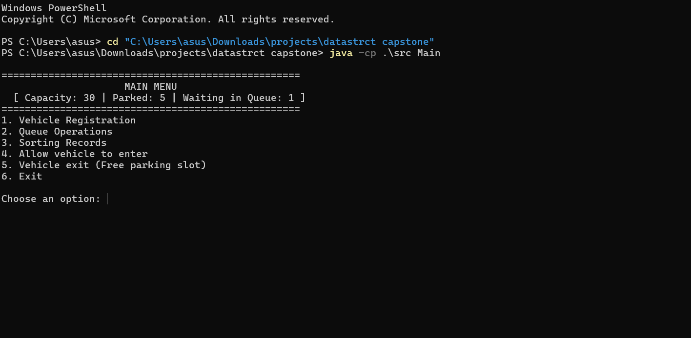
Shows the main options and current parking and queue counts.

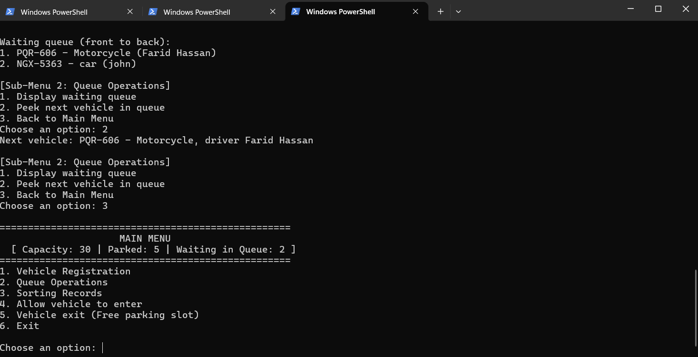
Shows the main menu after a vehicle has joined the waiting queue.

### Vehicle Registration Submenu
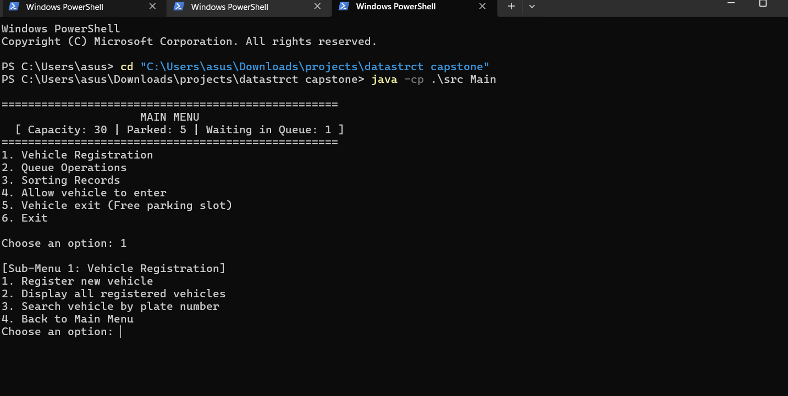
Shows the options to register, display, or search vehicle records.

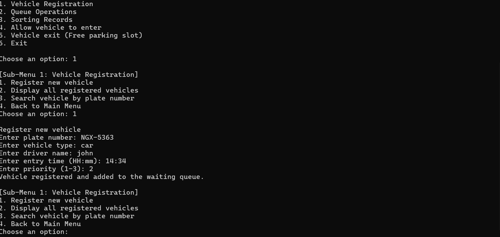
Shows a new vehicle successfully added to the records and waiting queue.

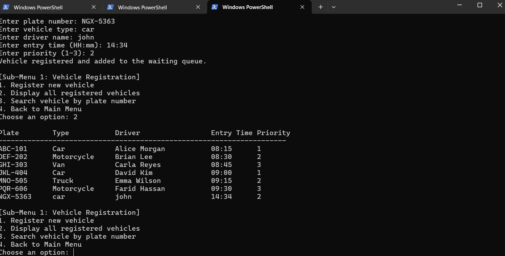
Shows the registered vehicles and their details in a table.

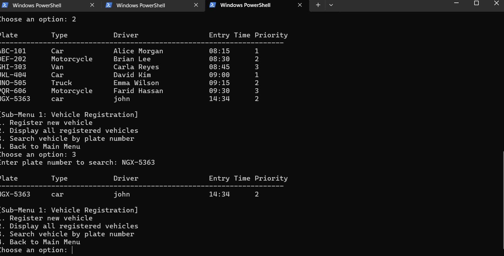
Shows the record returned by a plate-number search.

### Queue Operations Submenu
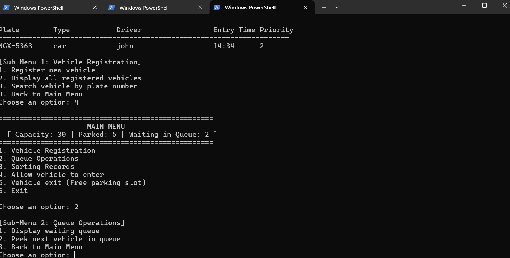
Shows the options to display the waiting queue or peek at the next vehicle.

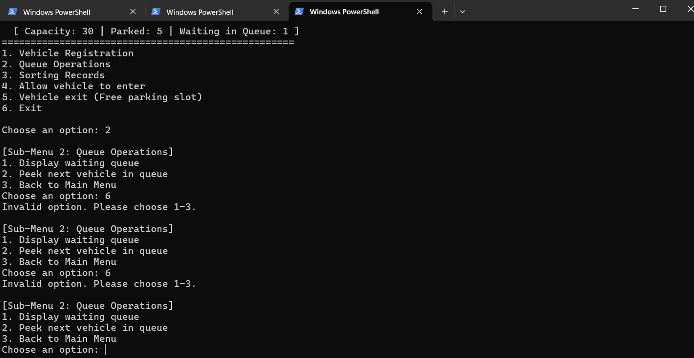
Shows the program rejecting invalid submenu choices and prompting for a valid option.

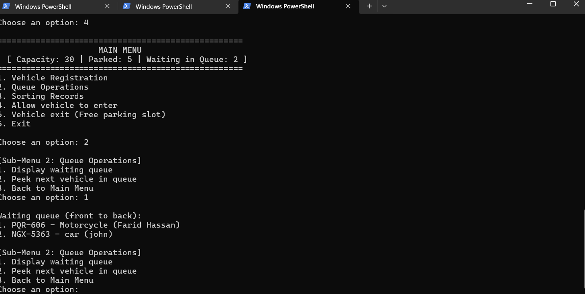
Shows queued vehicles in first-in, first-out order.

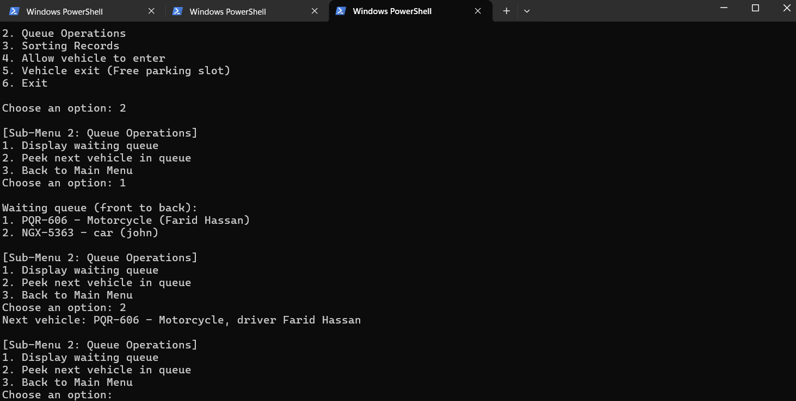
Shows the next vehicle without removing it from the queue.

### Sorting Records Submenu
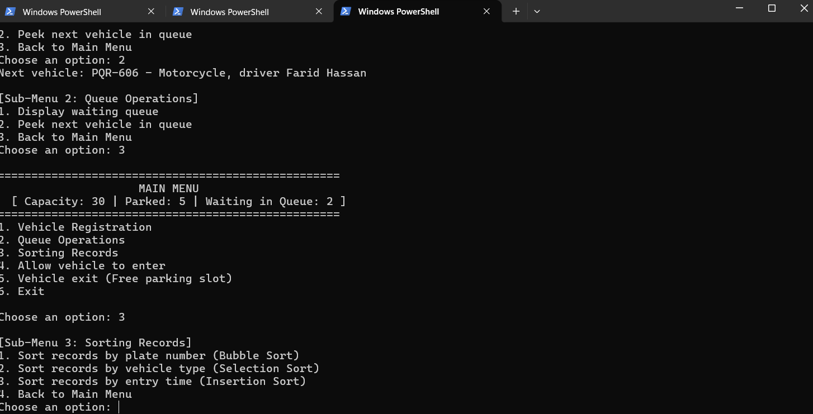
Shows records before and after Bubble Sort orders them by plate number.

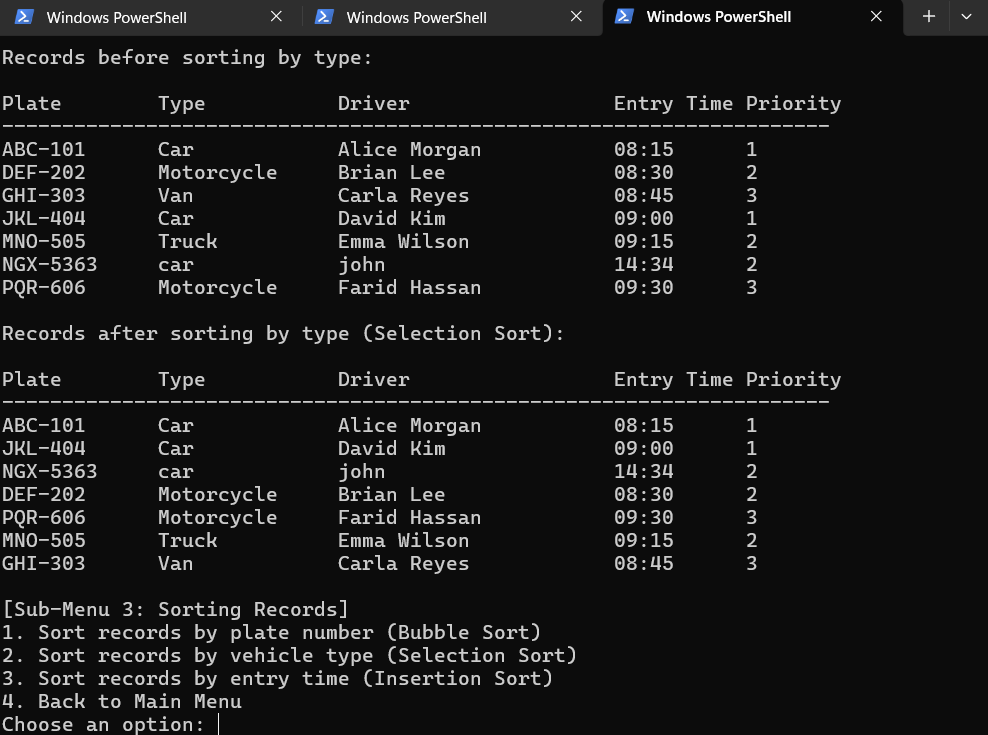
Shows records before and after Selection Sort orders them by vehicle type.

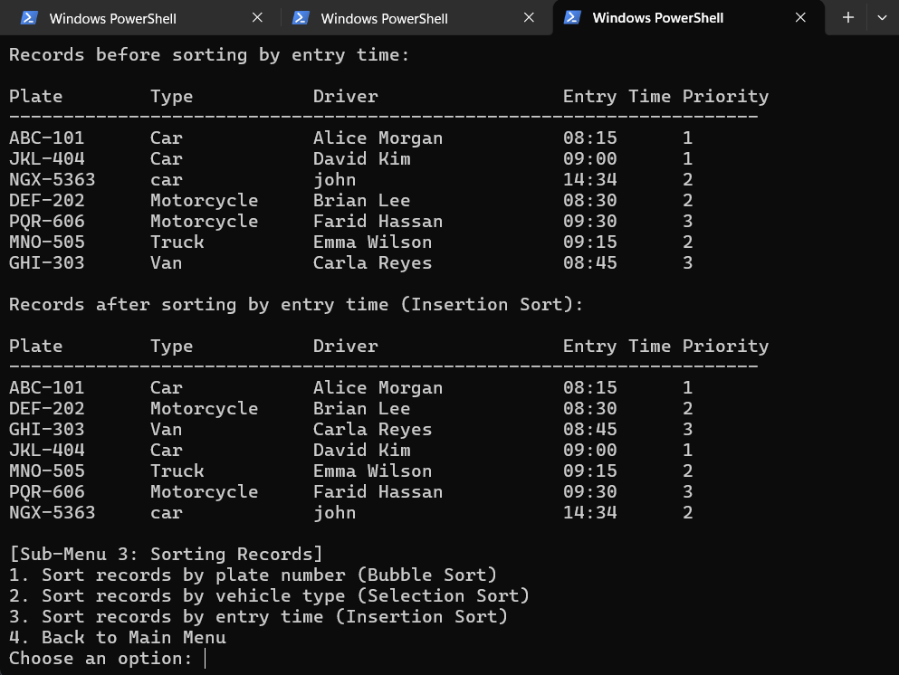
Shows records before and after Insertion Sort orders them by entry time.

### Parking Operations
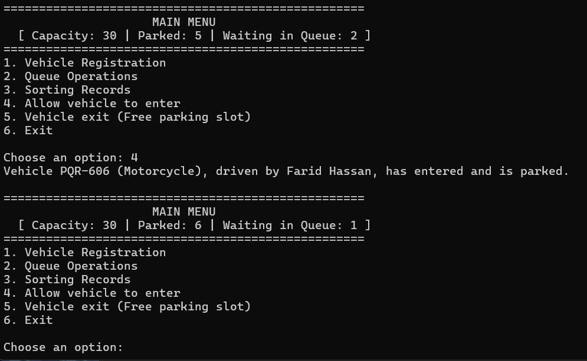
Shows a queued vehicle entering the parking lot.

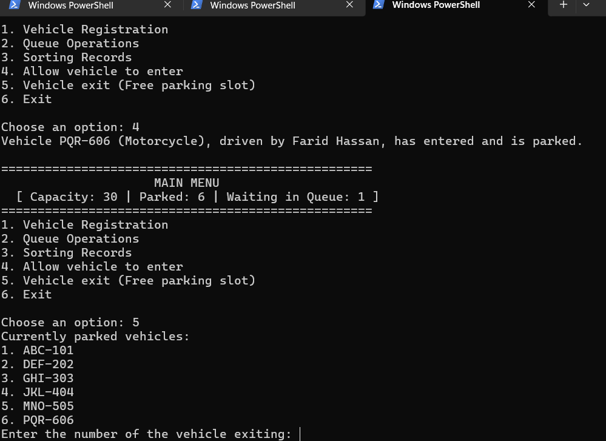
Shows the parked-vehicle list and the prompt to choose a vehicle for exit.

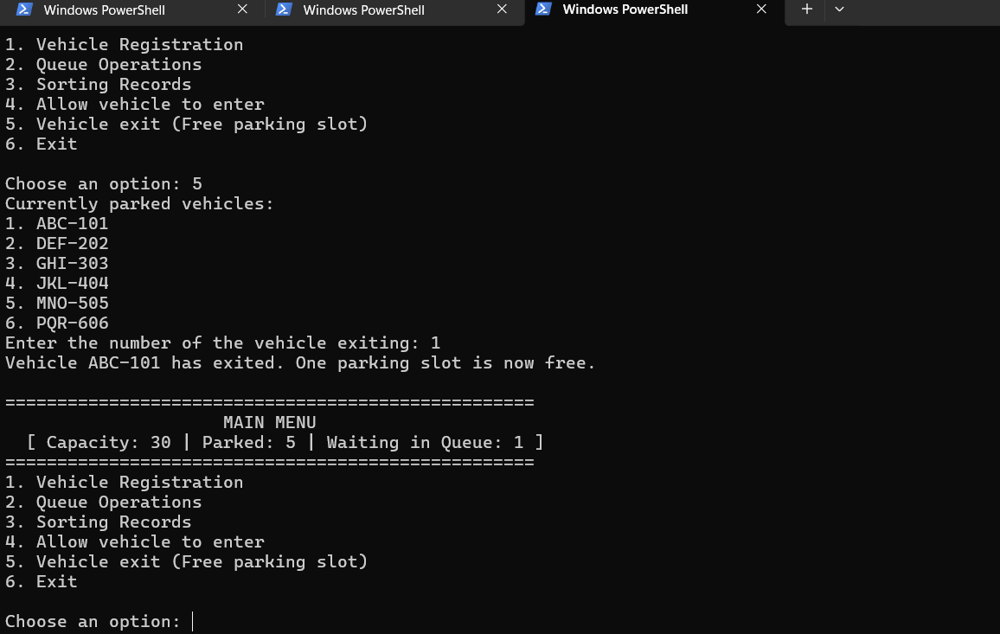
Shows a vehicle exiting and a parking slot becoming available.

### Program Exit
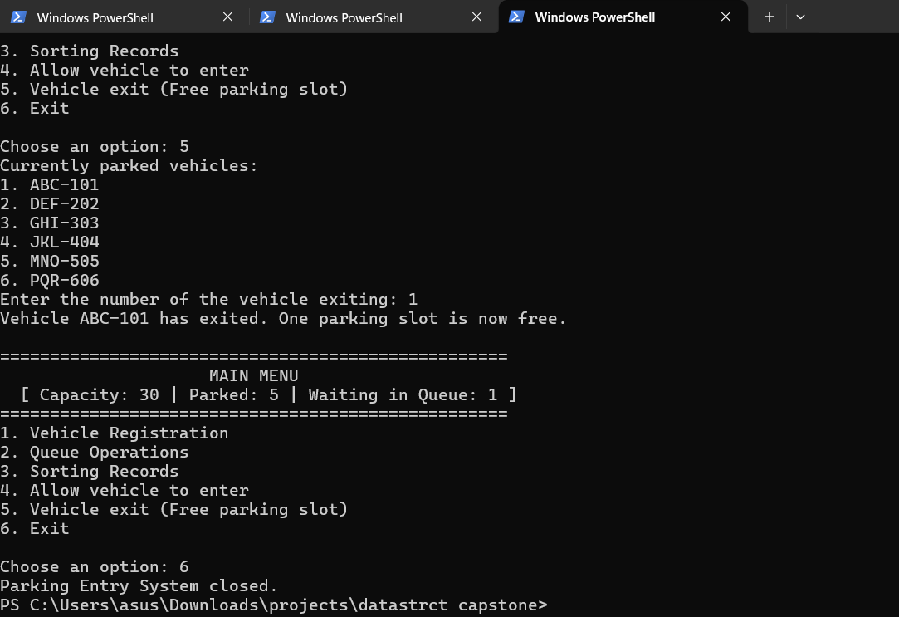
Shows the confirmation message after the application closes.